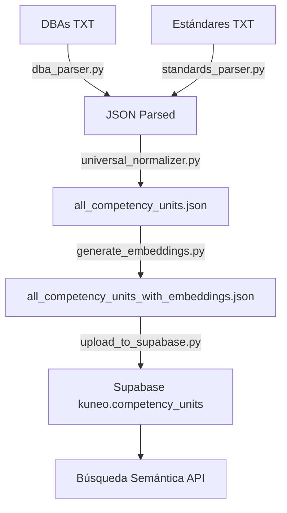

# KUNEO - Pipeline de Embeddings y Supabase

## 📋 Resumen

Pipeline completo para generar embeddings vectoriales de competency units y cargarlos a Supabase con búsqueda semántica.

**Input**: 1,426 competency units normalizados (410 DBAs + 1,016 Estándares)  
**Output**: Tabla `kuneo.competency_units` en Supabase con embeddings vectoriales

---

## 🗂️ Estructura

```
scripts/
├── embeddings/
│   └── generate_embeddings.py      # Genera embeddings con OpenAI
├── database/
│   └── upload_to_supabase.py       # Carga a Supabase
└── parsers/
    ├── dba_parser.py               # Parser de DBAs
    ├── standards_parser.py         # Parser de Estándares
    └── universal_normalizer.py     # Normalizador universal

data/processed/normalized/competency_units/
├── all_competency_units.json                    # Input (1,426 units)
└── all_competency_units_with_embeddings.json   # Output (con embeddings)
```

---

## 🚀 Uso

### 1. Generar Embeddings

```bash
python scripts/embeddings/generate_embeddings.py
```

**Proceso**:
- Lee `all_competency_units.json` (1,426 unidades)
- Genera embeddings con OpenAI `text-embedding-3-small` (1536 dims)
- Procesa en lotes de 100 unidades
- Guarda en `all_competency_units_with_embeddings.json`

**Requisitos**:
- `OPENAI_API_KEY` en `server/.env`
- Instalado: `pip install openai python-dotenv`

**Tiempo estimado**: ~2-3 minutos (depende del rate limit de OpenAI)

---

### 2. Upload a Supabase

```bash
python scripts/database/upload_to_supabase.py
```

**Proceso**:
- Lee `all_competency_units_with_embeddings.json`
- Conecta a Supabase con service role key
- Limpia tabla `kuneo.competency_units`
- Inserta en lotes de 100 registros
- Verifica inserción

**Requisitos**:
- `SUPABASE_URL` y `SUPABASE_SERVICE_ROLE_KEY` en `server/.env`
- Instalado: `pip install supabase python-dotenv`
- Tabla creada en Supabase (ver `schema.sql`)

**Tiempo estimado**: ~30 segundos

---

## 🗄️ Schema de Base de Datos

### Tabla: `kuneo.competency_units`

```sql
CREATE TABLE kuneo.competency_units (
    id UUID PRIMARY KEY,
    type TEXT NOT NULL DEFAULT 'competency_unit',
    source TEXT NOT NULL CHECK (source IN ('dba', 'standard')),
    subject TEXT NOT NULL,
    grade_range TEXT NOT NULL,
    difficulty INTEGER NOT NULL CHECK (difficulty BETWEEN 1 AND 5),
    content JSONB NOT NULL DEFAULT '{}',
    embedding vector(1536),
    created_at TIMESTAMPTZ DEFAULT NOW()
);
```

### Estructura del campo `content` (JSONB)

```json
{
  "competency": "Descripción de la competencia",
  "evidence": ["Evidencia 1", "Evidencia 2"],
  "example": "Ejemplo práctico",
  "concepts": ["concepto1", "concepto2"],
  "misconceptions": ["Error común 1", "Error común 2"],
  "metadata": {
    "dba_number": 1,           // solo DBAs
    "structure_mode": "math",  // solo Estándares
    "axis": "Pensamiento numérico",
    "axis_name": "..."
  }
}
```

### Índices

```sql
-- Búsqueda vectorial (HNSW para velocidad)
CREATE INDEX idx_competency_units_embedding_hnsw 
    ON kuneo.competency_units 
    USING hnsw (embedding vector_cosine_ops)
    WITH (m = 16, ef_construction = 64);

-- Filtros
CREATE INDEX idx_competency_units_subject ON kuneo.competency_units(subject);
CREATE INDEX idx_competency_units_grade_range ON kuneo.competency_units(grade_range);
CREATE INDEX idx_competency_units_difficulty ON kuneo.competency_units(difficulty);

-- JSONB
CREATE INDEX idx_competency_units_content_gin ON kuneo.competency_units USING gin(content);
```

### RLS Policies

```sql
-- Usuarios autenticados pueden leer todos los units
CREATE POLICY "Authenticated users can view all competency units"
    ON kuneo.competency_units FOR SELECT
    TO authenticated
    USING (true);

-- Service role tiene acceso completo
CREATE POLICY "Service role full access"
    ON kuneo.competency_units FOR ALL
    TO service_role
    USING (true)
    WITH CHECK (true);
```

---

## 🔍 Funciones RPC

### 1. Búsqueda Semántica

```sql
SELECT * FROM kuneo.search_competency_units(
    query_embedding := $1::vector,
    match_threshold := 0.5,
    match_count := 10,
    filter_subject := 'matematicas',
    filter_grade_range := '6-7',
    filter_difficulty := 2,
    filter_source := 'dba'
);
```

**Retorna**:
- `id`, `type`, `source`, `subject`, `grade_range`, `difficulty`, `content`
- `similarity` (0.0 - 1.0, donde 1.0 es idéntico)

### 2. Filtrado sin Embeddings

```sql
SELECT * FROM kuneo.get_competency_units(
    filter_subject := 'ciencias',
    filter_grade_range := '10-11',
    filter_difficulty := 4,
    filter_source := 'standard',
    limit_count := 20
);
```

---

## 📊 Estadísticas

| Métrica | Valor |
|---------|-------|
| **Total Units** | 1,426 |
| DBAs | 410 |
| Estándares | 1,016 |
| **Materias** | |
| Matemáticas | 291 |
| Ciencias | 395 |
| Sociales | 332 |
| Inglés | 285 |
| Lenguaje | 123 |
| **Dificultad** | |
| Nivel 1 | 577 (40.5%) |
| Nivel 2 | 270 (18.9%) |
| Nivel 3 | 289 (20.3%) |
| Nivel 4 | 290 (20.3%) |
| **Tamaño** | |
| JSON sin embeddings | 1.28 MB |
| JSON con embeddings | ~10-12 MB |
| Base de datos | ~15-20 MB |

---

## 🔧 Configuración

### Archivo `server/.env`

```env
# OpenAI
OPENAI_API_KEY=sk-...
OPENAI_MODEL=gpt-4
OPENAI_EMBEDDING_MODEL=text-embedding-3-small

# Supabase
SUPABASE_URL=https://zbcruqhuxfvcrntmospc.supabase.co
SUPABASE_SERVICE_ROLE_KEY=eyJ...
SUPABASE_ANON_KEY=eyJ...

# Server
PORT=3001
```

---

## 📦 Dependencias Python

```bash
pip install openai python-dotenv supabase
```

O con archivo `requirements.txt`:

```txt
openai>=1.0.0
python-dotenv>=1.0.0
supabase>=2.0.0
```

---

## ✅ Validación

Después de ejecutar el pipeline, verificar:

### 1. En consola Python

```python
# Verificar embeddings
import json
with open('data/processed/normalized/competency_units/all_competency_units_with_embeddings.json') as f:
    units = json.load(f)

print(f"Total: {len(units)}")
print(f"Con embeddings: {sum(1 for u in units if u.get('embedding'))}")
print(f"Dimensiones: {len(units[0]['embedding'])}")
```

### 2. En Supabase SQL Editor

```sql
-- Contar registros
SELECT COUNT(*) FROM kuneo.competency_units;

-- Ver distribución por materia
SELECT subject, COUNT(*) 
FROM kuneo.competency_units 
GROUP BY subject 
ORDER BY COUNT(*) DESC;

-- Verificar embeddings
SELECT COUNT(*) 
FROM kuneo.competency_units 
WHERE embedding IS NOT NULL;

-- Probar búsqueda semántica (requiere un embedding de prueba)
SELECT id, subject, grade_range, similarity
FROM kuneo.search_competency_units(
    (SELECT embedding FROM kuneo.competency_units LIMIT 1),
    0.7,
    5
);
```

---

## 🚨 Troubleshooting

### Error: "OPENAI_API_KEY no encontrada"

```bash
# Verificar .env
cat server/.env | grep OPENAI_API_KEY
```

### Error: "Tabla no encontrada"

```sql
-- Ejecutar en Supabase SQL Editor
-- Copiar y pegar el contenido de schema.sql
-- O solo la sección de competency_units
```

### Error: Rate limit de OpenAI

```python
# En generate_embeddings.py, aumentar delay:
DELAY_BETWEEN_BATCHES = 2  # segundos
```

### Error: Supabase connection timeout

```python
# En upload_to_supabase.py, reducir batch size:
BATCH_SIZE = 50
```

---

## 📖 Recursos

- [OpenAI Embeddings Docs](https://platform.openai.com/docs/guides/embeddings)
- [Supabase pgvector Docs](https://supabase.com/docs/guides/database/extensions/pgvector)
- [HNSW Index Performance](https://github.com/pgvector/pgvector#hnsw)

---

## 🔄 Flujo Completo



---

## 📝 Notas

- **Embeddings**: OpenAI `text-embedding-3-small` (1536 dims) es más económico y rápido que `text-embedding-3-large`
- **Índice HNSW**: Más rápido que IVFFlat para workloads típicos, pero usa más espacio
- **RLS**: Solo usuarios autenticados pueden leer, solo service role puede escribir
- **Cosine Similarity**: Métrica `<=>` en PostgreSQL (0 = idéntico, 2 = opuesto)

---

Creado: 2025-01-15  
Última actualización: 2025-01-15
